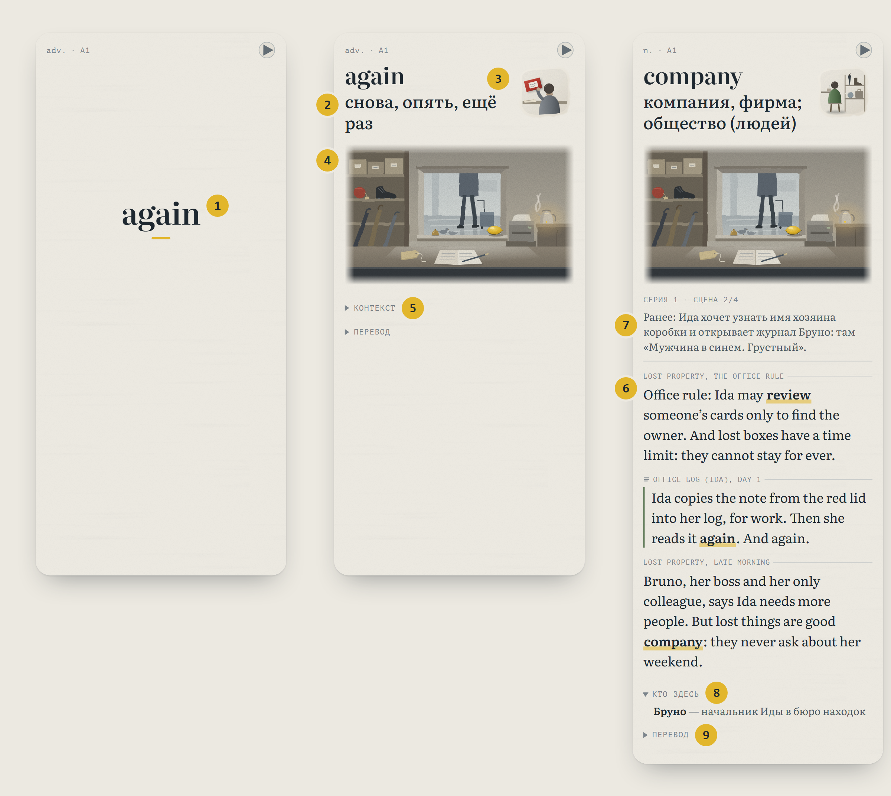

<p align="center">
  
</p>

<p align="center"><a href="./README.md">Русский</a> · <b>English</b></p>

In a usual deck, words are separate "word — translation" pairs with random examples. **In Wordkeep, all 3,060 Oxford 3000 words (A1–B2) form one mystery novel.** The card shows just the word, and the story comes in scenes: every 3–6 words add up to a short piece of text. Learn 15 new words a day and read the novel scene by scene.

> **Translations are in Russian.** The deck is made for Russian speakers.

<p align="center">
  <a href="https://github.com/phloya/wordkeep/releases/latest/download/Wordkeep-Oxford-3000.apkg"><b>Download the deck</b></a> (.apkg, 5 MB, newest version) → open the file in Anki. Details: <a href="#how-to-install">How to install</a>.
</p>

<p align="center">
  <picture>
    <source media="(prefers-color-scheme: dark)" srcset="./assets/readme/card-dark.png">
    
  </picture>
</p>

> Tidewell is a rainy port city where people forget their own lives. So everybody writes cards. A grey box, Item 1681, arrives at Lost Property with someone's life inside and a note: "Do not give this back to me. Even if I ask."

<p align="center">
  <a href="#whats-inside">What's inside</a> · <a href="#how-to-install">Install</a> · <a href="#the-book">The book</a> · <a href="#settings">Settings</a> · <a href="#faq">FAQ</a>
</p>

## What's inside

### Every word is a piece of one story

**3,060 words form 179 episodes of 17 words and 734 scenes.** Each word has its own story fragment, styled as a document of the city: a Lost Property log, a police report, a receipt, a night radio show. The fragments of 3–6 neighbouring words make a scene — about 90 words of text, 140 at most. The plot: Ida from Lost Property tries to find out whose life is in Box 1681.

<p align="center">
  
</p>

1. The word — nothing else on the front except the part of speech, the level and the audio.
2. The translation, right under the word.
3. A picture of the word.
4. A place picture: where it happens.
5. «контекст» (context) — the word's own story fragment, folded.
6. The story scene — on the last card of a group: the fragments of the last 3–6 words as one text.
7. «Ранее» (Previously) — a one-line reminder of what came before.
8. «Кто здесь» (Who's here) — the people in the scene, on tap.
9. «перевод» (translation) — the Russian text of the scene, on tap.

### The story brings words back

**A word you learned appears in the plot again after 1, 2, 4 … 128 days** — in another scene, from another character, sometimes with another meaning. More than 1,100 returns in total. It is spaced repetition, like Anki itself.

> Episode 82, Nils's note: "**Important**: bring the biscuits."<br>
> Episode 84, Ida's log: "Why am I worried about you? Not **important**."

<p align="center">
  
</p>

### The level grows with the story

**The first 30 episodes teach only A1 and A2 words.** But the scenes are real English sentences, so you need to read simple present-tense sentences already. A true beginner will struggle. Then B1 joins; Part 2 (episodes 144–178) is B2.

<p align="center">
  
</p>

Words per level: A1 775, A2 876, B1 813, B2 596.

### Pictures for memory

**Pictures for 3,057 of the 3,060 words and 15 place pictures** in one style, with day and night themes. A word with a picture is easier to remember.

<p align="center">
  
</p>

<details>
<summary>All 15 place pictures</summary>
<br>
<p align="center">
  
</p>
</details>

## How to install

1. Install Anki: [desktop](https://apps.ankiweb.net) and [Android](https://play.google.com/store/apps/details?id=com.ichi2.anki) are free, [iPhone and iPad](https://apps.apple.com/app/ankimobile-flashcards/id373493387) is paid. It has to be Anki itself: AnkiPro and AnkiApp are different apps, and the deck was not tested in them.
2. Download [`Wordkeep-Oxford-3000.apkg`](https://github.com/phloya/wordkeep/releases/latest/download/Wordkeep-Oxford-3000.apkg) from [Releases](../../releases/latest). The link always gives the newest version; you do not need older ones. The same deck is also on [AnkiWeb Shared Decks](https://ankiweb.net/shared/info/261868786).
3. Open the file in Anki:
   - **Desktop:** double-click the file or choose File → Import. Enable *Import any deck presets* to get 15 new cards a day, shown after your reviews.
   - **Android:** open the file and choose AnkiDroid.
   - **iPhone and iPad:** open the file in the Files app, tap Share and choose AnkiMobile.
4. Study in order: new cards follow the story, do not shuffle them.

## How to update

New versions come out in [Releases](../../releases); each one says what changed. You do not need the versions in between: go straight to the newest one.

1. If you study on several devices, sync them first.
2. Download the new [`Wordkeep-Oxford-3000.apkg`](https://github.com/phloya/wordkeep/releases/latest/download/Wordkeep-Oxford-3000.apkg) and open it in Anki, as when installing.

Your progress stays, no duplicates appear, and new texts and pictures are added. Your number of new cards a day stays too.

- **Moving to 2.0.** The card has changed: only the word on the front, and the story comes in scenes. Update as usual, over the old deck: your progress and review schedule stay as they are, and the card template updates by itself. If you edited the card template yourself, it will not update — copy the new one from [docs/template](./docs/template/) by hand, see [docs/customize.en.md](./docs/customize.en.md#if-the-template-did-not-update).
- Installed the deck before 10 October 2026 (versions 1.0–1.1)? The story has been retold since then, and an update keeps the old order of new cards. Better delete the deck and install the newest version from scratch.
- Cards you edited yourself are left alone: your edit stays, but the release's changes to that card do not arrive. The same goes for the card design if you changed the styling.
- You can make a backup before updating: File → Create Backup.
- To hear about new versions, click Watch → Custom → Releases at the top of the page (needs a GitHub account).

## The book

**[The book](https://phloya.github.io/wordkeep/book/) shows the episodes you have passed as continuous text, like chapters of a novel.** You do not need it to study.

- It opens in the browser, nothing to install. The interface is in Russian.
- Only the prologue is open at first. When you pass an episode in Anki, press "Открыть: Серия N" (Open: Episode N). No spoilers.
- "перевод" under a card shows its translation; "Весь перевод" shows the whole episode's.
- Progress is kept in the browser and is not linked to Anki.

## Settings

### New words per day

The default is **15**, with new cards shown after reviews. Any number works: a scene simply arrives once all its words are done. To change it:

1. Click the gear next to the deck.
2. Choose Options.
3. Under Daily Limits, type the number in New cards/day.
4. Click Save.

On a phone: Android — long-press the deck; iPhone — open the deck → Options.

A day often ends in the middle of a scene. The scene then arrives the next day, after the rest of its words.

### Fix a word or a translation — on a computer

1. Click Browse in Anki's top bar.
2. Find the word with the search.
3. Edit the field on the right; it saves right away.

While studying it is faster: Edit or the `E` key. In the `Example` field change only the text: it also holds the picture and the place picture. On the last card of a scene this field also holds the fragments of the scene's earlier cards; they are copies, and editing them does not change those cards.

### Change how cards look — on a computer

1. Tools → Manage Note Types.
2. "Wordkeep (Oxford 3000)" → Cards….
3. Styling → add a rule at the end. For example, to drop the «Ранее» line above a scene:

```css
.sc-prev { display: none !important; }
```

More recipes: [docs/customize.en.md](./docs/customize.en.md). How the deck is built: [docs/how-it-works.en.md](./docs/how-it-works.en.md).

### Move changes to your phone

1. Create a free account at [ankiweb.net](https://ankiweb.net).
2. On the computer, click Sync and sign in.
3. On the phone, sign in to the same account and sync too.

## Missed a few days

Nothing is lost: overdue reviews simply wait for you. Only reviews pile up — new words do not; a day never brings more than your limit.

- Do not delete the deck and do not use Reset Card on your cards (called Forget in older Anki versions): it wipes your progress and also puts cards back in their old places in the queue.
- To come back gently, cap today's reviews: gear → Options → Daily Limits → the *Today only* tab → Maximum reviews/day — 40–50. Once that limit is reached, Anki shows no new cards either, so no new cards arrive until the backlog is cleared. This works as long as *New cards ignore review limit* is off — it is off by default; leave it off. The *Today only* limit lasts one day: if some backlog is left, set it again tomorrow.

## FAQ

**How do I study?** Study Now → recall the translation → Show Answer (Space) → rate yourself. The rating decides when the word comes back.

| Button (key) | When to press |
| :--- | :--- |
| Again (1) | you did not remember; it comes back in a minute |
| Hard (2) | you remembered with effort |
| Good (3) | you remembered; the usual answer |
| Easy (4) | you knew it at once |

Every 3–6 words a scene appears under the answer: those words' fragments as one text, with «Ранее» above it and «Кто здесь» and «перевод» below. Read it, then rate the **word**, not how well you followed the scene. In reviews there is nothing to re-read: the scene simply sits below the answer. On such a card the ▶ button reads the whole scene.

**A new version is out — will I lose my progress?** No: import the new file over the old one, see [How to update](#how-to-update).

**How do I start over?** Delete the deck (gear → Delete) and import the file again. Your progress starts from zero.

**It shows 20, not 15?** "Import any deck presets" was off during import. Change the number by hand — see [Settings](#settings).

**Does it work offline?** Yes. Without a connection the Google Fonts do not load and the cards fall back to system fonts.

**Can I study on AnkiWeb?** Yes, but you cannot import the deck there: import it on a computer or phone, then sync. AnkiWeb has no text-to-speech; the ▶ button works in Anki desktop and AnkiDroid.

## License and links

- Texts, translations, pictures and design: [CC BY-NC-SA 4.0](./LICENSE.md) — share and adapt non-commercially, with attribution, under the same license.
- The deck is free. This repository is its official source.
- Oxford 3000™ is a word list © Oxford University Press. This project is not affiliated with OUP and uses only the words; all texts are original.
- Card fonts: Literata and PT Mono from Google Fonts, SIL Open Font License.
- Found a mistake in a text or translation? Fill in a [short form](../../issues/new?template=translation-error.yml). Other ways to help: [CONTRIBUTING.md](./CONTRIBUTING.md#in-english).
- Author: [phloya](https://github.com/phloya).
