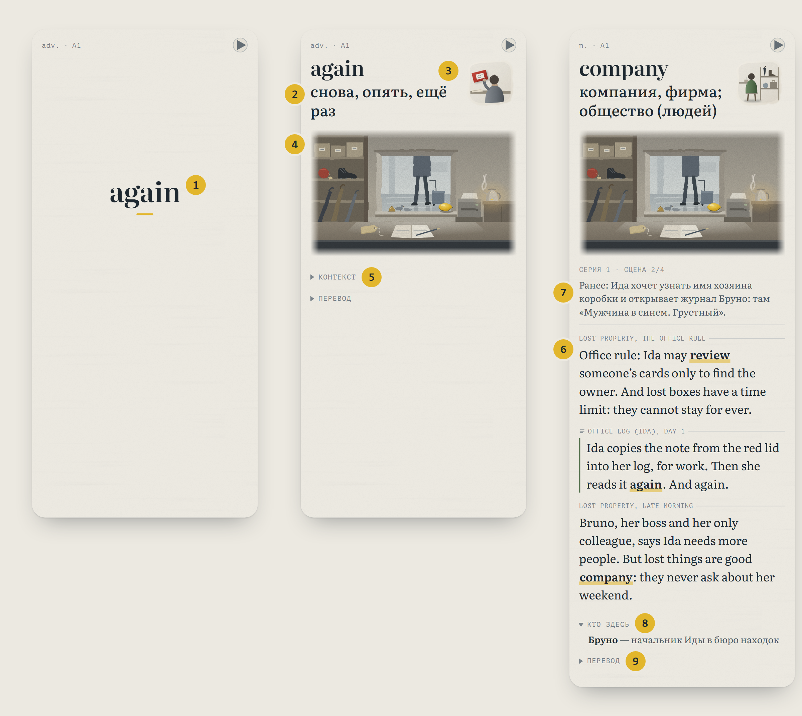

<p align="center">
  
</p>

<p align="center"><b>Русский</b> · <a href="./README.en.md">English</a></p>

В обычной колоде слова — разрозненные пары «слово — перевод» со случайными примерами. **В Wordkeep все 3060 слов Oxford 3000 (A1–B2) складываются в один детективный роман.** На карточке — только слово, а история приходит сценами: каждые 3–6 слов складываются в короткий кусок текста. Учишь 15 новых слов в день и читаешь роман по сценам.

<p align="center">
  <a href="https://github.com/phloya/wordkeep/releases/latest/download/Wordkeep-Oxford-3000.apkg"><b>Скачать колоду</b></a> (.apkg, 5 МБ, самая новая версия) → открой файл в Anki. Подробнее — в <a href="#как-установить">«Как установить»</a>.
</p>

<p align="center">
  <picture>
    <source media="(prefers-color-scheme: dark)" srcset="./assets/readme/card-dark.png">
    
  </picture>
</p>

> Тайдвелл — дождливый портовый город, где люди забывают собственную жизнь. Поэтому здесь все пишут карточки. В бюро находок приносят серую коробку №1681 с чужой жизнью внутри и запиской: «Не отдавайте мне это обратно. Даже если я попрошу».

<p align="center">
  <a href="#что-внутри">Что внутри</a> · <a href="#как-установить">Установка</a> · <a href="#книга">Книга</a> · <a href="#настройка">Настройка</a> · <a href="#вопросы-и-ответы">Вопросы</a>
</p>

## Что внутри

### Каждое слово — кусочек одной истории

**3060 слов складываются в 179 серий по 17 слов и 734 сцены.** У каждого слова свой фрагмент истории, оформленный как документ города: журнал бюро находок, рапорт, чек, ночной радиоэфир. Фрагменты 3–6 соседних слов вместе дают сцену — около 90 слов текста, не больше 140. Сюжет: Ида из бюро находок выясняет, чья жизнь лежит в коробке №1681.

<p align="center">
  
</p>

1. Слово — на лицевой стороне больше ничего нет, только часть речи, уровень и озвучка.
2. Перевод сразу под словом.
3. Рисунок слова.
4. Картина места, где это происходит.
5. «контекст» — фрагмент истории для этого слова, свёрнут.
6. Сцена истории — на последней карточке группы: фрагменты последних 3–6 слов одним текстом.
7. «Ранее» — одна строка о том, что было до этого.
8. «Кто здесь» — кто есть в сцене, по нажатию.
9. «перевод» — русский текст сцены, по нажатию.

### История сама возвращает слова

**Выученное слово снова появляется в сюжете через 1, 2, 4 … 128 дней** — в другой сцене, у другого героя, иногда с другим смыслом. Всего больше 1100 возвращений. Это интервальное повторение, как в самой Anki.

> Серия 82, записка Нильса: «**Важно**: принести печенье».<br>
> Серия 84, журнал Иды: «Почему я за тебя волнуюсь? **Неважно**».

<p align="center">
  
</p>

### Уровень растёт вместе с историей

**Первые 30 серий учат только слова A1 и A2.** Но сцены написаны настоящими английскими предложениями, поэтому нужно уже читать простые фразы в настоящем времени. Если начинаешь совсем с нуля, будет тяжело. Дальше добавляется B1, вторая часть (серии 144–178) — B2.

<p align="center">
  
</p>

Слов по уровням: A1 — 775, A2 — 876, B1 — 813, B2 — 596.

### Картинки для памяти

**Рисунки к 3057 словам из 3060 и 15 картин мест** в одном стиле, дневная и ночная тема. Слово с картинкой запоминается лучше.

<p align="center">
  
</p>

<details>
<summary>Все 15 картин мест</summary>
<br>
<p align="center">
  
</p>
</details>

## Как установить

1. Поставь Anki: [на компьютер](https://apps.ankiweb.net) и [на Android](https://play.google.com/store/apps/details?id=com.ichi2.anki) — бесплатно, [на iPhone и iPad](https://apps.apple.com/app/ankimobile-flashcards/id373493387) — платно. Нужна именно Anki: AnkiPro и AnkiApp — другие приложения, колода в них не проверялась.
2. Скачай [`Wordkeep-Oxford-3000.apkg`](https://github.com/phloya/wordkeep/releases/latest/download/Wordkeep-Oxford-3000.apkg) из [Releases](../../releases/latest). Ссылка всегда ведёт на самую новую версию, старые ставить не нужно. Та же колода есть в [каталоге AnkiWeb](https://ankiweb.net/shared/info/261868786).
3. Открой файл в Anki:
   - **Компьютер:** дважды щёлкни по файлу или выбери «Файл → Импортировать» (File → Import). Включи галочку «Импортировать конфигурации колод» (Import any deck presets) — будет 15 новых карточек в день, новые после повторений.
   - **Android:** открой файл и выбери AnkiDroid.
   - **iPhone и iPad:** открой файл в приложении «Файлы», нажми «Поделиться» и выбери AnkiMobile.
4. Учи по порядку: новые карточки идут по сюжету, не перемешивай их.

## Как обновить колоду

Новые версии выходят в [Releases](../../releases), в каждой написано, что изменилось. Промежуточные версии ставить не нужно: сразу бери самую новую.

1. Если учишь на нескольких устройствах, сначала синхронизируй их.
2. Скачай новый [`Wordkeep-Oxford-3000.apkg`](https://github.com/phloya/wordkeep/releases/latest/download/Wordkeep-Oxford-3000.apkg) и открой его в Anki, как при установке.

Прогресс сохранится, дублей не будет, новые тексты и рисунки добавятся. Твоё число новых карточек в день тоже останется.

- **Переход на 2.0.** Карточка стала другой: на лицевой стороне только слово, история приходит сценами. Обновляйся как обычно, поверх старой колоды: прогресс и расписание повторений не меняются, шаблон карточки обновится сам. Если ты менял шаблон карточки, он не обновится — скопируй новый из [docs/template](./docs/template/) вручную, см. [docs/customize.md](./docs/customize.md#если-шаблон-не-обновился).
- Ставил колоду до 10 октября 2026 года (версии 1.0–1.1)? С тех пор история пересказана заново, а порядок новых карточек при обновлении останется старым. Лучше удали колоду и поставь самую новую версию с нуля.
- Карточки, которые ты исправлял сам, обновление не трогает: правка останется, но и новое из релиза в такую карточку не придёт. То же с оформлением, если ты менял стили.
- Перед обновлением можно сделать резервную копию: File → Create Backup.
- Чтобы узнавать о новых версиях, нажми вверху страницы Watch → Custom → Releases (нужен аккаунт GitHub).

## Книга

**[Книга](https://phloya.github.io/wordkeep/book/) — пройденные серии сплошным текстом, как главы романа.** Для учёбы не обязательна.

- Открывается в браузере, ставить ничего не нужно.
- Сначала открыт только пролог. Прошёл серию в Anki — нажми «Открыть: Серия N». Без спойлеров.
- «перевод» под карточкой — перевод фрагмента, «Весь перевод» — всей серии.
- Прогресс хранится в браузере, с Anki не связан.

## Настройка

### Сколько новых слов в день

По умолчанию — **15**, новые карточки идут после повторений. Подойдёт любое число: сцена просто приходит, когда пройдены все её слова. Чтобы поменять:

1. Нажми ⚙ справа от колоды.
2. Выбери «Параметры».
3. В разделе «Ежедневный лимит» в поле «Новых карточек в день» впиши число.
4. Нажми «Сохранить».

На телефоне: Android — зажми колоду, iPhone — открой колоду → Options.

День часто кончается посреди сцены. Тогда сцена придёт на следующий день, после оставшихся слов этой сцены.

### Исправить слово или перевод — на компьютере

1. Нажми «Список» в верхней панели Anki.
2. Найди слово через поиск.
3. Исправь поле справа — сохраняется сразу.

Во время учёбы быстрее: «Правка» или клавиша `E`. В поле `Example` меняй только текст: там же спрятаны рисунок и картина места. У последней карточки сцены в этом поле лежат и фрагменты предыдущих карточек сцены — это копии, правка в них не меняет сами те карточки.

### Изменить вид карточки — на компьютере

1. «Инструменты → Управление типами записей».
2. «Wordkeep (Oxford 3000)» → «Карточки…».
3. «Таблица стилей» → допиши правило в конец. Например, убрать строку «Ранее» над сценой:

```css
.sc-prev { display: none !important; }
```

Ещё рецепты — в [docs/customize.md](./docs/customize.md), как устроена колода — в [docs/how-it-works.md](./docs/how-it-works.md).

### Перенести изменения на телефон

1. Заведи бесплатный аккаунт на [ankiweb.net](https://ankiweb.net).
2. На компьютере нажми «Синхронизация» и войди в аккаунт.
3. На телефоне войди в тот же аккаунт и тоже нажми синхронизацию.

## Пропустил несколько дней

Ничего не потеряно: просроченные повторения просто ждут тебя. Копятся только повторения — новые слова не накапливаются, за день придёт не больше твоего лимита.

- Не удаляй колоду и не применяй к карточкам «Сбросить карточку» (Reset Card; в старых версиях Anki — «Забыть», Forget): это обнуляет прогресс и возвращает карточкам старые места в очереди.
- Чтобы вернуться мягко, ограничь повторения на сегодня: ⚙ → «Параметры» → «Ежедневный лимит» (Daily Limits) → вкладка «Только сегодня» (Today only) → «Максимум повторяемых в день» (Maximum reviews/day) — 40–50. Когда этот лимит исчерпан, Anki не показывает и новые карточки, так что пока хвост повторений не разобран, новых не будет. Это работает, пока выключена настройка «Лимит повторений не влияет на новые» (New cards ignore review limit) — по умолчанию она выключена, не включай её. Лимит «Только сегодня» действует один день: если хвост ещё остался, завтра поставь его снова.

## Вопросы и ответы

**Как учить?** «Учить» → вспомни перевод → «Показать ответ» (пробел) → оцени себя. От оценки зависит, когда слово вернётся.

| Кнопка (клавиша) | Когда жать |
| :--- | :--- |
| «Снова» (1) | не вспомнил — вернётся через минуту |
| «Трудно» (2) | вспомнил с трудом |
| «Хорошо» (3) | вспомнил — обычный ответ |
| «Легко» (4) | знал сразу |

Каждые 3–6 слов под ответом появляется сцена: фрагменты этих слов одним текстом, над ней «Ранее», под ней «Кто здесь» и «перевод». Прочитай её, а потом оцени **слово**, а не то, как понял сцену. При повторении перечитывать ничего не нужно: сцена просто лежит под ответом. Кнопка ▶ на такой карточке читает всю сцену.

**Вышла новая версия — прогресс пропадёт?** Нет: импортируй новый файл поверх старого, см. [«Как обновить колоду»](#как-обновить-колоду).

**Как начать заново?** Удали колоду (⚙ → «Удалить») и импортируй файл ещё раз. Прогресс начнётся с нуля.

**Стоит 20, а не 15?** При импорте не отметили «Импортировать конфигурации колод». Поменяй число вручную — см. [«Настройка»](#настройка).

**Работает без интернета?** Да. Без сети не загрузятся шрифты из Google Fonts, и карточки покажутся системными шрифтами.

**Можно учиться в AnkiWeb?** Да, но импортировать колоду туда нельзя: импортируй на компьютере или телефоне и синхронизируй. Озвучки в AnkiWeb нет, кнопка ▶ работает в Anki на компьютере и в AnkiDroid.

## Лицензия и ссылки

- Тексты, переводы, рисунки и оформление — [CC BY-NC-SA 4.0](./LICENSE.md): можно делиться и переделывать некоммерчески, с указанием автора и под той же лицензией.
- Колода бесплатная. Официальный источник — этот репозиторий.
- Oxford 3000™ — список слов © Oxford University Press. Проект не связан с OUP; из списка взяты только слова, все тексты оригинальные.
- Шрифты карточек — Literata и PT Mono из Google Fonts, лицензия SIL Open Font License.
- Нашёл ошибку в тексте или переводе — заполни [короткую форму](../../issues/new?template=translation-error.yml). Как ещё помочь — в [CONTRIBUTING.md](./CONTRIBUTING.md).
- Автор — [phloya](https://github.com/phloya).
